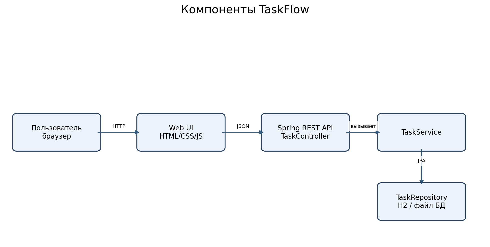
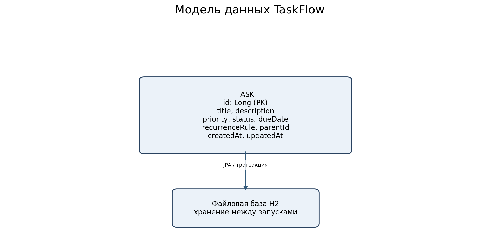
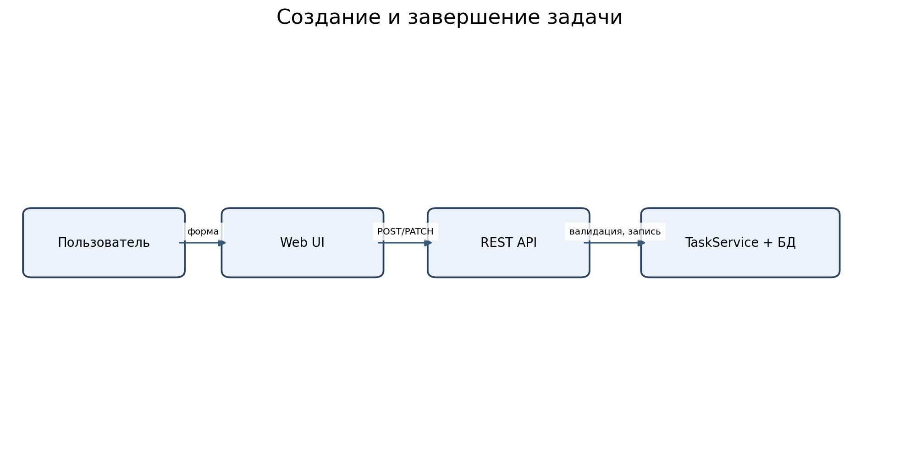
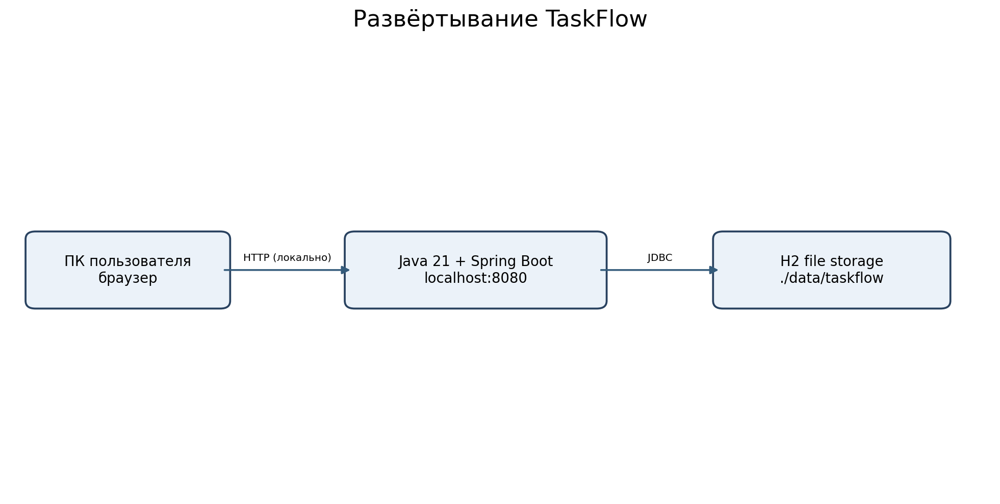
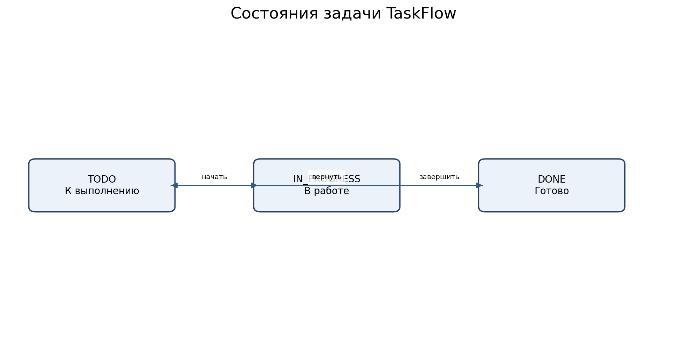

# Описание дизайна программного обеспечения

Для Web-приложения «TaskFlow — Трекер задач»

Версия 0.2  
Подготовил: Хейлик Д.С.  
БГУИР  
28.10.2026

## Оглавление

1. Введение (1.1–1.5)
2. Обзор дизайна (2.1–2.2.15)
3. Проектные представления (001–011)
4. Решения (ADR-0001…0004)
5. Приложения (трассировка)

## История изменений

| Name | Date | Reason For Changes | Version |
|---|---|---|---|
| Хейлик Д.С. | 26.10.2026 | Исходный вариант архитектуры по SRS 0.1 | 0.1 |
| Хейлик Д.С. | 28.10.2026 | Добавлены повторяемость и CSV; согласован план v3 | 0.2 |

## 1. Введение {#1-introduction}

### 1.1 Назначение документа {#11-document-purpose}

SDD задаёт реализацию требований TaskFlow, структуру модулей, данные, HTTP-контракты и развёртывание. Документ предназначен разработчику, тестировщику, заказчику и преподавателю. Точные требования — в `../srs/srs-taskflow.md`, распределение работ — в `../plan/iteration-plan.md`.

### 1.2 Область применения {#12-subject-scope}

Проектируется TaskFlow 1.0: браузерный Kanban, CRUD задач, статусы, приоритеты, сроки, фильтры, поиск, CSV-экспорт и ограниченное повторение задач. Данные сохраняются в локальной файловой БД. За пределами решения: учётные записи, командный режим, календарный интерфейс, интеграции, сложные правила повторений и расширенная сортировка.

### 1.3 Определения, акронимы и сокращения {#13-definitions-acronyms-and-abbreviations}

| Term | Definition |
|---|---|
| ADR | Architecture Decision Record — протокол архитектурного решения |
| API | Application Programming Interface — программный интерфейс |
| CRUD | Create, Read, Update, Delete — основные операции с сущностью |
| DTO | Data Transfer Object — объект обмена данными |
| JPA | Java Persistence API — доступ к данным через сущности |
| REST | стиль программного интерфейса на HTTP |
| SDD | Software Design Description — описание дизайна |
| SRS | Software Requirements Specification — спецификация требований |

### 1.4 Ссылки {#14-references}

| Документ | Версия | Путь | Статус |
|---|---|---|---|
| SRS TaskFlow | 0.2 | `../srs/srs-taskflow.md` | нормативный |
| План итераций | 3 | `../plan/iteration-plan.md` | нормативный |
| ADR-0001…0004 | 2026-10-28 | `../adr/` | нормативные |
| Шаблон SDD курса | 2026 | `Templates/sdd/sdd-template.md` | справочный |

### 1.5 Обзор документа {#15-document-overview}

Раздел 2 связывает заинтересованные стороны и точки зрения. Раздел 3 описывает реализуемые представления с графикой, алгоритмами и интерфейсами. Раздел 4 поясняет альтернативы. Раздел 5 связывает функции, SRS и архитектуру. Изменения фиксируются в истории и рассматриваются через Pull Request.

## 2. Обзор дизайна {#2-design-overview}

### 2.1 Задачи стейкхолдеров {#21-stakeholder-concerns}

| Стейкхолдер | Задачи | Представления |
|---|---|---|
| Пользователь | Быстрое управление задачами, отсутствие потерь | 001, 004, 005, 008 |
| Заказчик | Срок, цена, приоритет повторений | 002, 007, 011, план |
| Разработчик | Простая структура, контракты, тестируемость | 002, 003, 004, 009 |
| Тестировщик | Проверяемые сценарии и обработка ошибок | 004, 005, 007, 008 |
| Преподаватель | Трассируемость SRS → SDD → ADR | разделы 4–5 |

### 2.2 Выбранные точки зрения {#22-selected-viewpoints}

Все 15 точек зрения рассмотрены; там, где отдельная диаграмма избыточна, точка зрения документируется общим представлением.

#### 2.2.1 Контекст

Используется: **001-context: пользователь и веб-приложение**.

#### 2.2.2 Композиция

Используется: **002-components: UI, REST, сервис и репозиторий**.

#### 2.2.3 Логическое представление

Используется: **003-data: класс Task и перечисления Priority/Status**.

#### 2.2.4 Физическое представление

Используется: **006-deployment: ПК и Java-процесс**.

#### 2.2.5 Структура

Используется: **002-components: границы слоёв**.

#### 2.2.6 Зависимости

Используется: **002-components: направленные зависимости UI → API → Service → Repository**.

#### 2.2.7 Информация

Используется: **003-data: постоянная модель и правила**.

#### 2.2.8 Интерфейс

Используется: **004-api: HTTP JSON контракты**.

#### 2.2.9 Взаимодействие

Используется: **005-sequence: создание и завершение**.

#### 2.2.10 Алгоритм

Используется: **007-algorithm: создание повторной задачи**.

#### 2.2.11 Динамика состояний

Используется: **008-states: TODO/IN_PROGRESS/DONE**.

#### 2.2.12 Параллелизм

Используется: **009-concurrency: транзакции и защита от повторной обработки**.

#### 2.2.13 Паттерны

Используется: **010-patterns: layered architecture, Repository, DTO**.

#### 2.2.14 Развёртывание

Используется: **006-deployment: локальное окружение**.

#### 2.2.15 Ресурсы

Используется: **011-resources: память, соединения, объём задач**.

## 3. Проектные представления {#3-design-views}

### 001-context — Контекст

- **ID:** 001-context
- **Title:** Внешний контекст TaskFlow
- **Viewpoint:** Контекст
- **Representation:** Пользователь работает с веб-интерфейсом через браузер. Приложение не обращается к внешним API. Граница включает UI, API и хранение; данные доступны в пределах учебного развёртывания.
- **More Information:** REQ-DIST-001/002, REQ-FUNC-002.

### 002-components — Компоненты

- **ID:** 002-components
- **Title:** Компоненты монолита
- **Viewpoint:** Композиция, структура, зависимости
- **Representation:** 

Модуль `web` запрашивает `/api/tasks`; `TaskController` валидирует DTO; `TaskService` реализует CRUD, переходы состояний, правило повторения; `TaskRepository` сохраняет `Task`. Направление зависимостей только UI → API → Service → Repository.
- **More Information:** REQ-FUNC-001…010, REQ-MAINT-001; ADR-0001, ADR-0003.

### 003-data — Информационная модель

- **ID:** 003-data
- **Title:** Схема Task
- **Viewpoint:** Information, Logical
- **Representation:** 

`Task`: `id Long PK`, `title VARCHAR(200) NOT NULL`, `description TEXT`, `priority ENUM LOW/MEDIUM/HIGH`, `status ENUM TODO/IN_PROGRESS/DONE`, `dueDate DATE NULL`, `recurrenceRule ENUM NONE/DAILY/WEEKLY`, `parentId Long NULL`, `createdAt`, `updatedAt`, `version`. Ссылка `parentId` — предшествующая задача. Для защиты от двойного завершения применяется сравнение состояния и версии в транзакции; последовательная операция создаёт максимум одну новую задачу.
- **More Information:** REQ-FUNC-010/013; ADR-0002, ADR-0004.

### 004-api — Контракты HTTP API

- **ID:** 004-api
- **Title:** JSON REST API
- **Viewpoint:** Interface
- **Representation:**

| Метод | URI | Результат | Ошибки |
|---|---|---|---|
| GET | `/api/tasks` | 200, JSON-массив | 500/503 |
| POST | `/api/tasks` | 201, DTO задачи | 400/422 |
| PUT | `/api/tasks/{id}` | 200, обновлённая задача | 404/422/409 |
| PATCH | `/api/tasks/{id}/status` | 200, новый статус | 404/409 |
| DELETE | `/api/tasks/{id}` | 204 | 404 |
| GET | `/api/tasks/export.csv` | 200, `text/csv; charset=utf-8` | 500 |

Фильтры `status`, `priority` и поисковый параметр `q` допускаются в GET; поиск нечувствителен к регистру. Сообщение об ошибке: `{ "code": "VALIDATION_ERROR", "message": "..." }`. При создании статус по умолчанию `TODO`.
- **More Information:** REQ-FUNC-001…011, REQ-SEC-001/004; ADR-0003.

### 005-sequence — Взаимодействие

- **ID:** 005-sequence
- **Title:** Создание и завершение
- **Viewpoint:** Interaction
- **Representation:** 

Нормальный путь: форма → POST /api/tasks → валидация → запись → 201 → перерисовка колонки TODO. Для завершения выполняется PATCH; если `recurrenceRule` равен DAILY/WEEKLY, транзакция сохраняет DONE и создаёт новую TODO. Ошибка БД приводит к откату и ответу 503; UI не показывает ложного успеха.
- **More Information:** REQ-FUNC-001/004/010/013, REQ-REL-001/002; ADR-0004.

### 006-deployment — Развёртывание

- **ID:** 006-deployment
- **Title:** Учебное локальное окружение
- **Viewpoint:** Physical, Deployment
- **Representation:** 

Java 21, Spring Boot, файловая H2 `jdbc:h2:file:./data/taskflow`; запуск через `java -jar taskflow.jar`. Пользователь открывает `http://localhost:8080`; для сетевого размещения требуется HTTPS на обратном прокси согласно REQ-SEC-003. Секреты не хранятся в репозитории.
- **More Information:** REQ-INST-001/002, REQ-DIST-001/002, REQ-SEC-003; ADR-0001/0002.

### 007-algorithm — Создание повторной задачи

- **ID:** 007-algorithm
- **Title:** Повторение при завершении
- **Viewpoint:** Algorithm
- **Representation:**

```text
completeTask(id):
  begin transaction
  task = repository.findForUpdate(id) or 404
  if task.status == DONE: return task // идемпотентность
  task.status = DONE
  repository.save(task)
  if task.recurrenceRule in {DAILY, WEEKLY}:
    require task.dueDate != null
    delta = 1 day if DAILY else 7 days
    next = copy(title, description, priority, recurrenceRule)
    next.status = TODO; next.dueDate = task.dueDate + delta
    next.parentId = task.id
    repository.save(next)
  commit transaction
  return task
```

При конкурирующем запросе второй запрос не создаёт дубль. Сложность O(1) операций БД для одной задачи.
- **More Information:** REQ-FUNC-013, REQ-REL-001; ADR-0004.

### 008-states — Состояния

- **ID:** 008-states
- **Title:** Жизненный цикл задачи
- **Viewpoint:** State Dynamics
- **Representation:** 

Допустимы переходы TODO → IN_PROGRESS → DONE и возврат DONE → TODO. При переходе к DONE включается правило повторения; при обратном переводе уже созданная дочерняя задача не удаляется автоматически.
- **More Information:** REQ-FUNC-002/004/013.

### 009-concurrency — Конкурентный доступ

- **ID:** 009-concurrency
- **Title:** Защита от гонок
- **Viewpoint:** Concurrency
- **Representation:** REST-запросы обрабатываются пулом сервера. Операции изменения записи выполняются в транзакциях с проверкой версии (`@Version`) либо блокировкой на время завершения повторяющейся задачи; конфликт возвращает 409. В 1.0 нет фонового планировщика.
- **More Information:** REQ-REL-001/002, REQ-FUNC-013.

### 010-patterns — Паттерны

- **ID:** 010-patterns
- **Title:** Применённые шаблоны
- **Viewpoint:** Patterns
- **Representation:** Layered Architecture разделяет UI/API/Service/Repository; Repository инкапсулирует SQL; DTO отделяет контракт от JPA; транзакционный сервис реализует идемпотентное завершение.
- **More Information:** REQ-MAINT-001, REQ-REUSE-001; ADR-0001…0004.

### 011-resources — Ресурсы

- **ID:** 011-resources
- **Title:** Ограничения учебного развёртывания
- **Viewpoint:** Resources
- **Representation:** Целевая нагрузка — 500 задач, время ответа не более 2 с для 95 % запросов (SRS). При демонстрации достаточно ПК с 4 ГБ ОЗУ; приложение использует стандартный пул HTTP-потоков и файловую БД. Точные параметры выделения памяти выбираются после измерений, а не объявляются подтверждёнными заранее.
- **More Information:** REQ-PERF-001/002, REQ-AVAIL-001.

## 4. Решения {#4-decisions}

| ID | Решение | Варианты | Итог |
|---|---|---|---|
| ADR-0001 | Spring Boot монолит | Spring Boot / микросервисы / Java HTTP | Монолит: скорость разработки |
| ADR-0002 | Хранилище H2 file | H2 / PostgreSQL / JSON | H2: простой локальный запуск |
| ADR-0003 | Простой Web UI + REST | HTML/JS / React / Thymeleaf | REST + HTML/JS |
| ADR-0004 | Повторения при завершении | синхронно / scheduler / заранее | синхронная транзакция |

## 5. Приложения {#5-appendixes}

### Приложение А. Матрица трассировки функций

| Функция | Приоритет | SRS | SDD |
|---|---:|---|---|
| F-01 Project setup & build | 10 | REQ-INST-001/002, REQ-BUILD-001/002 | 002, 003, 004, 005, 006, 007 |
| F-02 Task persistence & API | 10 | REQ-FUNC-001/003/005/010 | 002, 003, 004, 005, 006, 007 |
| F-03 Kanban board | 10 | REQ-FUNC-002/004 | 002, 003, 004, 005, 006, 007 |
| F-04 Task creation form | 10 | REQ-FUNC-001/009 | 002, 003, 004, 005, 006, 007 |
| F-05 Task editing | 20 | REQ-FUNC-003/009 | 002, 003, 004, 005, 006, 007 |
| F-06 Task deletion | 20 | REQ-FUNC-005 | 002, 003, 004, 005, 006, 007 |
| F-07 Task priorities | 20 | REQ-FUNC-006 | 002, 003, 004, 005, 006, 007 |
| F-08 Search tasks | 30 | REQ-FUNC-007 | 002, 003, 004, 005, 006, 007 |
| F-09 Status transitions | 10 | REQ-FUNC-004 | 002, 003, 004, 005, 006, 007 |
| F-10 Filter tasks | 30 | REQ-FUNC-008 | 002, 003, 004, 005, 006, 007 |
| F-11 Input validation & errors | 10 | REQ-FUNC-009, REQ-SEC-001/004 | 002, 003, 004, 005, 006, 007 |
| F-12 Testing & operations | 10 | REQ-PERF-001/002, REQ-REL-001/002, REQ-OBS-001/002 | 002, 003, 004, 005, 006, 007 |
| F-13 Responsive refinements | 40 | REQ-PORT-002, UI SRS §3.1.1 | 002, 003, 004, 005, 006, 007 |
| F-14 Due date indicators | 30 | REQ-FUNC-001/003, UI SRS §3.1.1 | 002, 003, 004, 005, 006, 007 |
| F-15 CSV export | 40 | REQ-FUNC-011 (new in SRS 0.2) | 002, 003, 004, 005, 006, 007 |
| F-16 Advanced sorting | 50 | REQ-FUNC-012 (deferred) | 002, 003, 004, 005, 006, 007 |
| F-17 Recurring tasks | 20 | REQ-FUNC-013 (new in SRS 0.2) | 002, 003, 004, 005, 006, 007 |

### Приложение Б. Модели и изображения

- `models/architecture.sysml` — описательная модель модулей.
- `models/data-model.sysml` — модель сущности Task.
- `models/workflow.sysml` — описание переходов.
- `images/architecture.png`, `images/data-model.png`, `images/sequence.png`, `images/deployment.png`, `images/states.png` — графические схемы.

Графические схемы построены по описанным проектным решениям. Текстовые модели SysML — учебные исходные наброски и не заявлены как прошедшие проверку компилятором SysML v2.
